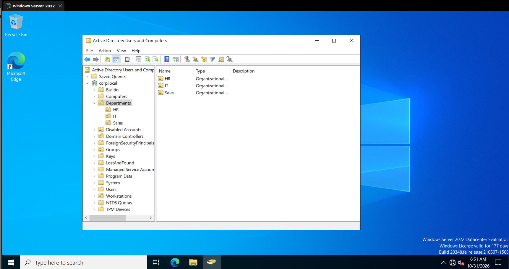
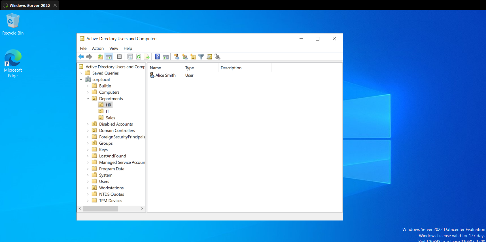
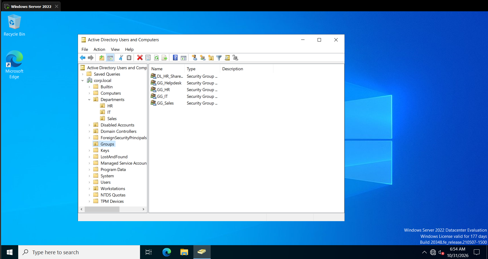
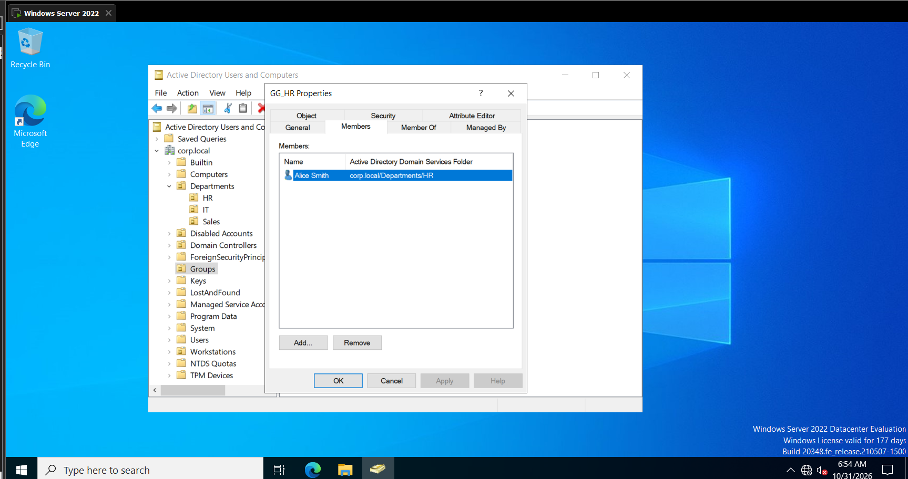
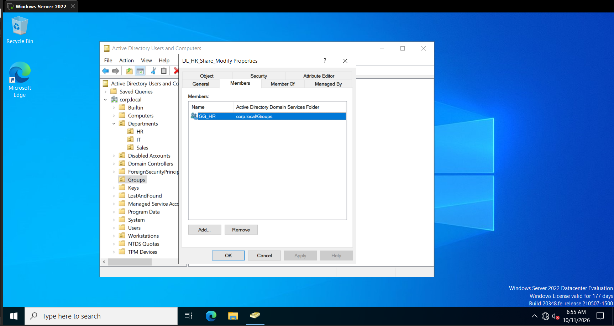
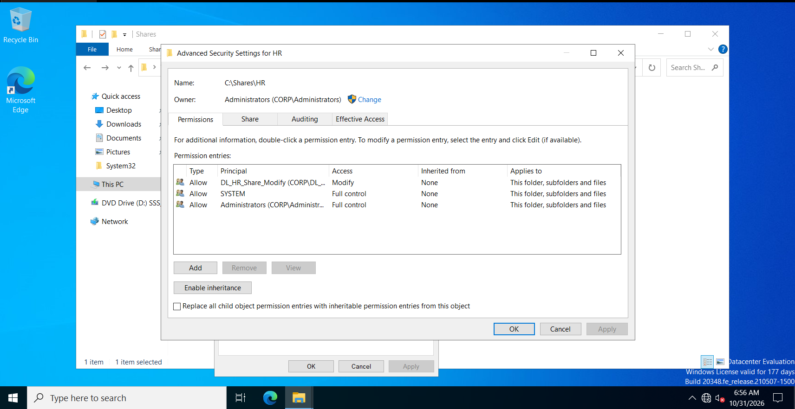
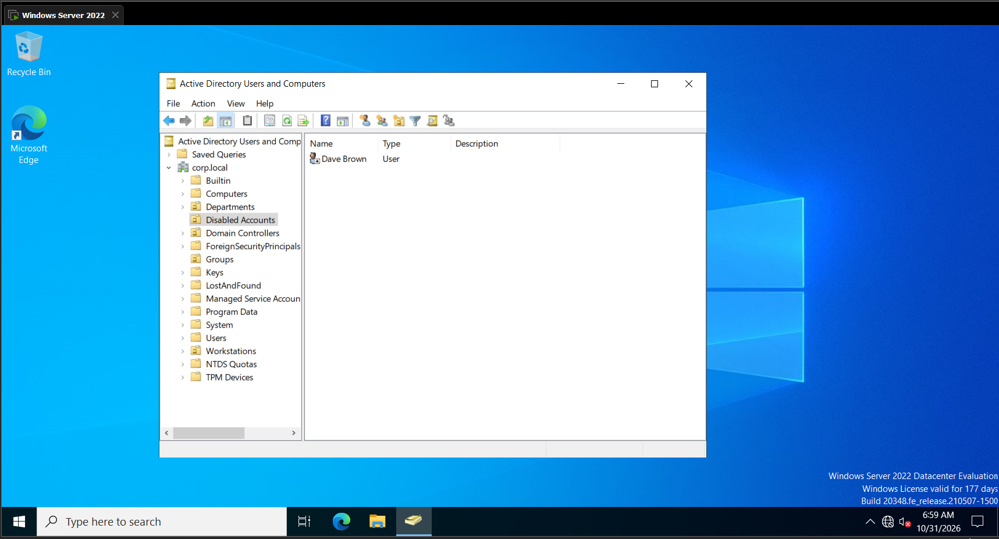
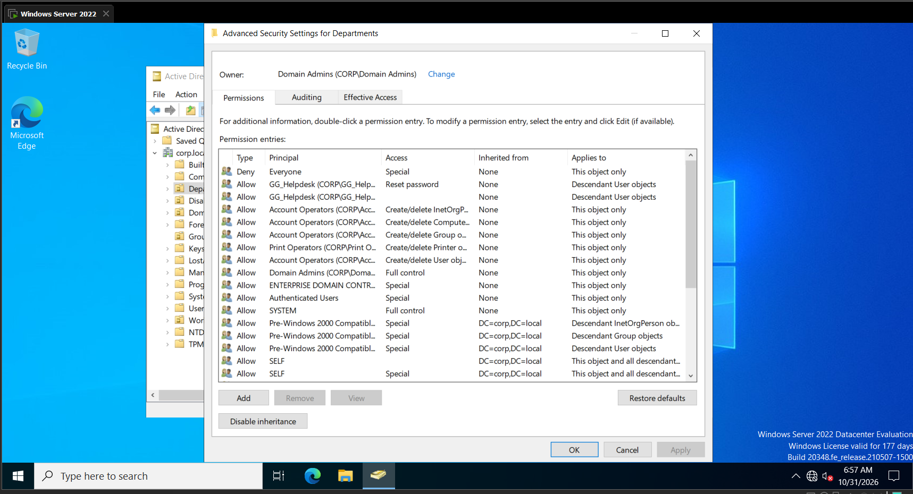
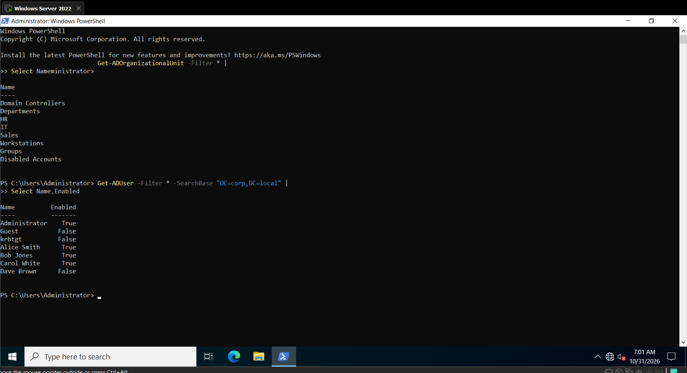
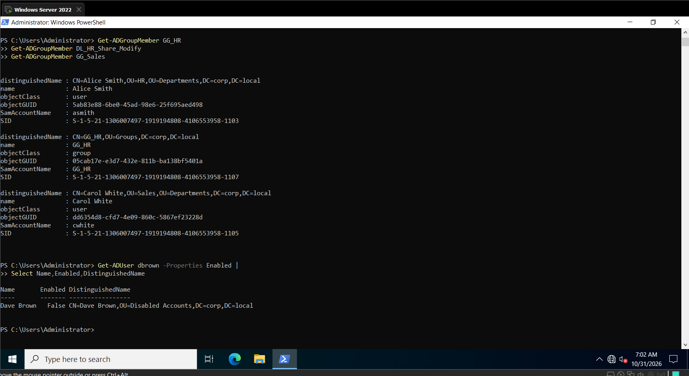

# Lab 2: Active Directory Users, Groups and Organizational Units

## Overview

This lab focuses on building a company structure using Active Directory Domain Services (AD DS) on Windows Server 2022.

The objectives were to create Organizational Units (OUs), manage user accounts, configure security groups, implement AGDLP, configure shared folder permissions, perform account administration tasks, and delegate password-reset permissions to the Helpdesk group.

## Lab Environment

| Component | Configuration |
|---|---|
| Server OS | Windows Server 2022 |
| Domain Controller | DC01 |
| Domain | corp.local |
| Client OS | Windows 11 |
| Virtualization | VMware Workstation |
| Directory Service | Active Directory Domain Services |

## 1. Organizational Unit Structure

Created the following OU hierarchy:

```text
corp.local
│
├── Departments
│   ├── HR
│   ├── IT
│   └── Sales
│
├── Workstations
├── Groups
└── Disabled Accounts
```

### Purpose of the OU structure

- **Departments:** Organizes employees according to their departments.
- **HR, IT, Sales:** Stores department-specific user accounts.
- **Workstations:** Provides a dedicated location for computer accounts.
- **Groups:** Stores security groups.
- **Disabled Accounts:** Stores accounts belonging to former employees.

Organizational Units help administrators organize accounts, apply Group Policies and delegate administrative permissions.



## 2. User Account Creation

Created four Active Directory user accounts:

| Name | Username | Department |
|---|---|---|
| Alice Smith | asmith | HR |
| Bob Jones | bjones | IT |
| Carol White | cwhite | Sales |
| Dave Brown | dbrown | Sales |

Alice Smith was created manually through Active Directory Users and Computers (ADUC).

The remaining accounts were created using PowerShell with the `New-ADUser` cmdlet.

All accounts were configured to require a password change at the next logon.



## 3. Security Group Creation

Created five security groups:

| Group | Scope | Purpose |
|---|---|---|
| GG_HR | Global | HR department membership |
| GG_IT | Global | IT department membership |
| GG_Sales | Global | Sales department membership |
| GG_Helpdesk | Global | Helpdesk administration |
| DL_HR_Share_Modify | Domain Local | HR shared folder access |



### Group Membership

- Alice Smith → GG_HR
- Bob Jones → GG_IT
- Bob Jones → GG_Helpdesk
- Carol White → GG_Sales
- Dave Brown → GG_Sales
- GG_HR → DL_HR_Share_Modify



## 4. AGDLP Implementation

Implemented the AGDLP model:

**Accounts → Global Groups → Domain Local Groups → Permissions**

Example:

```text
Alice Smith (asmith)
       |
       v
     GG_HR
       |
       v
DL_HR_Share_Modify
       |
       v
  HR Shared Folder
       |
       v
  Modify Permission
```

This approach avoids assigning file permissions directly to individual users and makes access management easier.



## 5. HR Shared Folder and NTFS Permissions

Created the shared folder:

`C:\Shares\HR`

Published it as an SMB network share named `HR`.

### Configured permissions

**Share permissions:**
- Everyone: Full Control (lab configuration).

**NTFS permissions:**
- Administrators: Full Control.
- SYSTEM: Full Control.
- CORP\DL_HR_Share_Modify: Modify.

Used PowerShell and `icacls` to configure NTFS permissions.

Share permissions and NTFS permissions work together to determine effective network access. The more restrictive effective permission applies.



## 6. Active Directory Administration Tasks

Practiced common system administration operations using ADUC and PowerShell.

| Task | PowerShell Command |
|---|---|
| Create user | `New-ADUser` |
| Create group | `New-ADGroup` |
| Add group member | `Add-ADGroupMember` |
| Reset password | `Set-ADAccountPassword` |
| Force password change | `Set-ADUser` |
| Unlock account | `Unlock-ADAccount` |
| Disable account | `Disable-ADAccount` |
| Move account | `Move-ADObject` |

### Employee Leaver Process

Simulated the departure of Dave Brown.

Steps performed:

1. Disabled Dave's account.
2. Removed him from his group memberships.
3. Moved his account to the Disabled Accounts OU.
4. Verified that the account was disabled and no longer had its previous group memberships.

Accounts were disabled instead of deleted to preserve their directory records.



## 7. Helpdesk Delegation

Used the Delegation of Control Wizard in Active Directory Users and Computers.

Delegated the following permission to `GG_Helpdesk`:

**Reset user passwords and force password change at next logon.**

The delegation was applied to the Departments OU.

This allows Helpdesk members to reset passwords for departmental users without requiring Domain Admin privileges.



## 8. PowerShell Verification

Used PowerShell to verify:

- Organizational Unit creation.
- User accounts and their enabled status.
- Security group memberships.
- AGDLP group nesting.
- Disabled employee account status.
- User account location.



Additional verification:




## 9. Key Learning Outcomes

After completing this lab, I gained practical experience with:

- Creating and managing Active Directory Organizational Units.
- Creating and managing domain user accounts.
- Creating Global and Domain Local security groups.
- Implementing AGDLP group nesting.
- Configuring SMB shares and NTFS permissions.
- Resetting passwords and unlocking accounts.
- Managing employee leaver processes.
- Delegating administrative permissions to Helpdesk groups.
- Using PowerShell for routine Active Directory administration.

---

**Status:** Completed

**Platform:** Windows Server 2022 | VMware Workstation
